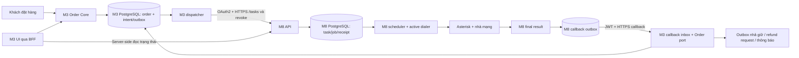

# Kế hoạch kết nối M3 ↔ M8 — đơn hàng, gọi xác nhận và nhận kết quả

> **ĐÃ ĐƯỢC THAY THẾ ngày02/11/2026 bởi [bộ kế hoạch0.2 trong repo BP](../../../../ginsengfood-business-platform/docs/integration/m3-m8/README.md).** Bản0.1 dưới đây giữ để truy vết; không dùng làm chuẩn triển khai. Lượt rà lại đã bổ sung phản hồi12/10, thư chốt13/10, operations17/10, caller/gift, UI/BFF cụ thể và sửa rollback. Kết luận QA cũ không bao phủ các nguồn bị bỏ sót đó.

**Phiên bản:** 0.1 · **Ngày:** 02/11/2026, Asia/Bangkok (+07) · **Chủ trì:** Nguyễn Quốc Toàn · **Task:** M3-023; phối hợp M8-001.

**Trạng thái:** ĐÃ KHẢO SÁT MÃ VÀ HỢP ĐỒNG; PHƯƠNG ÁN TRIỂN KHAI ĐỀ XUẤT. Chưa triển khai các WP bên dưới, chưa chạy kiểm đầu-cuối hai ứng dụng trong lượt lập kế hoạch này. Đây là tài liệu kế hoạch chung, chưa thay phiếu task READY hoặc biên bản nghiệm thu.

**Phạm vi bạn đã chốt trong chat:** “Mọi đơn M3 đánh dấu cần gọi ngay từ đợt đầu”. Bao phủ toàn bộ nhóm đơn được M3 chọn, không giới hạn đợt đầu ở COD. “Ngay từ đợt đầu” nói về phạm vi chức năng; lịch thực hiện cuộc gọi vẫn tuân giờ gọi, deadline, quyền gọi và năng lực nhà mạng.

## 1. Kết quả cần đạt và định hướng

Một đơn được tạo trong M3, được M3 đánh dấu cần xác nhận qua IVR, phải tự đi qua chuỗi:

**Đơn M3 → lệnh gửi bền vững → M8 nhận và lập lịch → cuộc gọi → kết quả cuối → M3 kiểm lại điều kiện → xác nhận/hủy đơn, nhả giữ và tạo yêu cầu hoàn tiền khi cần → người vận hành thấy trạng thái đúng.**

M8 đã có nền gọi điện. Bạn xác nhận đơn ảo đã gọi người thật thành công; hồ sơ M8 cũng ghi lượt 23/10 nghe lời thoại, bấm 1 thành công. Kế hoạch kế thừa nền đó, tập trung vào vòng đời đơn M3 và hai chiều giao tiếp. Nghiệm thu mới phải chứng minh chính đơn M3 đi hết chuỗi, kể cả lỗi, retry, hủy và cuộc gọi đến muộn. [S01]

Các kết quả kinh doanh và vận hành:

| Kết quả | Cách kiểm được |
|---|---|
| Mọi đơn đã gắn cờ đều được xử lý | Đối soát đơn cần gọi với intent, receipt hoặc disposition có lý do; không có đơn mất dấu |
| Không gọi thêm do retry HTTP | Timeout/restart gửi lại cùng task/key; chỉ một job hợp lệ cho cùng task |
| Không xác nhận/hủy/nhả hàng/hoàn tiền trùng | Receipt DB, khóa đơn và idempotency của từng side effect; thử race/crash |
| Khách không phải gọi lại nhân viên để hoàn tất luồng chuẩn | Áp chính sách tự động đã có; lỗi kỹ thuật cuối cùng không âm thầm chuyển sang tuyến gọi thủ công |
| Checkout chịu được M8 tạm ngừng | Checkout chỉ ghi transaction nội bộ; dispatcher giao sau, có hạn và lý do thất bại |
| Mở rộng có số liệu | Đo riêng tốc độ đơn, API, callback, kênh và CPS; tăng đúng nơi nghẽn |

**Đề xuất kiến trúc:** HTTPS Target V1 + outbox/inbox PostgreSQL thuộc domain Order; tái dùng module `ivr` và runtime M8. Chưa thêm broker hoặc một microservice trung gian. M3 giữ toàn bộ business truth; M8 chịu trách nhiệm thực thi cuộc gọi.

## 2. Baseline khảo sát và mức bằng chứng

| Nguồn | Baseline đã đọc | Ý nghĩa |
|---|---|---|
| M3 | `C:\Projects\ginsengfood-business-platform`, `toandeptrai`, `547dd59a0c1d3c1257afbd0688a50ab084c5715f` | Cây sạch lúc khảo sát; đây là nguồn mã M3 dùng cho nhận định |
| M8 | `C:\Projects\ginsengfood-ivr`, `main`, `c9f0cd188f4966d07aafb3155039656b1b451034` | Cây sạch lúc khảo sát; không kiểm trực tiếp máy đang phục vụ |
| OpenAPI M8 | `1.0.0-draft.45` | Chuẩn cấu trúc wire hiện hành; callback có YAML riêng |
| IR-06/07/08 | Gói r2 đầu tệp còn ghi draft.44 | Nghĩa vụ producer/consumer, chính sách và ma trận nghiệm thu; có vài đoạn cần đồng bộ |
| M8 gọi thật | Bạn xác nhận 02/11; hồ sơ lượt 23/10 | Bằng chứng phần gọi điện, không thay chứng cứ nối M3 mới |
| Test trong hai repo | Đã tìm thấy test và báo cáo cũ | Lượt này CHƯA CHẠY test/build/DB/call; không cộng test của nhiều SHA thành kết quả chung |

GitNexus: BP chưa có index đăng ký trên máy; khảo sát trực tiếp source. M8 có index ở `00b90044`, lệch HEAD phần tracker; đã dùng query/context cho định tuyến và kiểm lại file thật. Không reindex, không dùng graph để tự tuyên bố đầy đủ impact. Trước triển khai symbol vẫn phải làm impact theo luật repo.

### 2.1. Đã có gì, còn thiếu gì

| Mảng | Đã kiểm thấy | Phần phải làm |
|---|---|---|
| Tạo đơn M3 | Transaction, idempotency, OrderCreatedEvent | Intent/outbox bền vững và chọn route IVR; event trong memory không phải hàng đợi bền vững |
| Route xác nhận | COD 24/7 đang `STAFF_MANUAL`; online đang `PAYMENT`; `IVR` còn dành cho S3 | Chọn route theo điều kiện M3, phối hợp payment và deadline; không đổi toàn bộ đơn sang IVR |
| Nút “IVR” cũ | Endpoint admin thực hiện xác nhận thủ công; từ chối route IVR | Endpoint callback S2S mới và domain command riêng; không gọi lại nguyên hàm manual |
| Khóa và phiên bản | Pessimistic order lock; JPA `@Version` | Chốt version dành cho snapshot xác nhận; quan hệ callback/revoke/đổi đơn |
| Auth M3 | OAuth client credentials, token cache, TLS CA pin, JWKS verifier | Nối vào HTTP client/callback filter, fail closed khi thiếu cấu hình |
| M8 intake/revoke | API, receipt, idempotency, policy/scheduler đã có | Client M3, mapping dữ liệu, kiểm chung đúng contract |
| M8 callback | Outbox, retry, lease/fencing, Target V1 transport | **Validator hiện chỉ cho Target V1 trong M3 sandbox MOCK; cần WP mở profile production có kiểm** |
| Hủy và hoàn tiền | V252 có 5 lý do IVR; stock/voucher release; có luồng tạo refund request | Nối chính sách IVR atomically; refund request có policy/evidence/system actor; chưa coi là tiền đã hoàn |
| Theo dõi | M8 có API admin/operations và telemetry | BFF/read model/UI M3, quyền, audit, cảnh báo và đối soát |

Nguồn mã: [S02]–[S14]. Không khôi phục Golden Hour callback legacy đã bỏ ở D-17; bảng lịch sử `ivr_call_queue` còn tồn tại không có nghĩa dispatcher mới đã có. [S07]

### 2.2. Các lệch nguồn cần khép trong WP00

| Lệch đã thấy | Hướng xử lý đề xuất |
|---|---|
| OAS draft.45, gói r2/IR-07 còn draft.44 | Ghim draft.45 cho công việc mới, ghi compatibility note. Diff chỉ thêm `/operations` và schema liên quan; intake/revoke/callback không đổi. Giữ nguyên baseline/ZIP/manifest đã ghim hash |
| IR-08 E02 còn coi 24/7 ONLINE là lỗi | Sửa kỳ vọng hiện hành theo r2 nhận bốn tổ hợp; lỗi required/enum/schema vẫn phải thử |
| IR-08 E11 còn gate snapshot stale/unknown cũ | Snapshot r2 là metadata, ngoại trừ restriction; đồng bộ expected result với IR-06 và source, không tái bật gate cũ |
| IR-06 còn lịch V3 GH 3 lượt; quyết định 20/10 và code/spec mới là V4 GH 2 lượt | Dùng V4 cho task mới khi registry/mode được nạp đúng; cập nhật handoff/fixtures bằng revision có truy vết, giữ V1–V3 bất biến cho task cũ. Definition code không chứng minh registry production đã triển khai |
| OAS cho `sales-platform` hoặc `order-core`, runtime allowlist chỉ `order-core` | Producer dùng `order-core`; ghi rõ profile áp dụng và test chống alias ngoài allowlist |
| M8 nhận GH COD nhưng schema M3 hiện cấm GH COD | Giữ luật bán hàng M3. Hỗ trợ giao thức không tự cấp quyền bán GH COD. Chỉ gửi tổ hợp M3 hợp lệ và được đánh dấu |
| Flow cũ dùng `IVR_INVALID_NUMBER`/`IVR_DECLINED`; V252 đã chuẩn hóa mã | Dùng `IVR_INVALID_PHONE`/`IVR_CUSTOMER_REQUEST` và ba mã còn lại của V252/IR-06 |
| Tài liệu tháng 8 nói lỗi kỹ thuật không hủy | Bị chính sách r2/TN-2 và nền S3 thay thế: final invalid do hệ thống vẫn hủy, fault NONE; không tính lỗi khách |

Đây là công việc đối chiếu và sửa tài liệu hiện hành, không phải quyền tự sửa hợp đồng đã niêm phong. Nếu diff mới làm thay đổi semantics, lập revision mới và ghi rõ trước khi triển khai.

## 3. Ranh giới trách nhiệm và kiến trúc



| M3 sở hữu | M8 sở hữu |
|---|---|
| Đơn nào cần gọi; payment/order/stock/recall/sale-lock truth | Intake, receipt, lịch gọi, thời gian, giới hạn kênh/CPS |
| Snapshot đã chốt và version; producer + revoke | Thực thi cuộc gọi, phím bấm, số lượt, chuẩn hóa final result |
| Inbox, revalidation và chuyển trạng thái đơn | Callback outbox, retry và replay kết quả đã có |
| Nhả hàng/quota/voucher, yêu cầu hoàn tiền, thông báo | API kỹ thuật/admin, dữ liệu tiến trình đã che PII |
| Danh tính và quyền người dùng, UI/BFF | Xác minh quyền service/admin và audit phía M8 |

Hai DB tách biệt. M3 không đọc trực tiếp DB M8; M8 không sửa DB M3 hay gọi Ops Core để tự quyết đơn. Boundary Java: consumer dùng provider-owned `port.in`; HTTP, persistence và DTO ở đúng module/layer. [S15]

## 4. Công nghệ, công cụ và lợi ích

| Quyết định | Công cụ/nền dùng | Lợi ích | Giới hạn/chi phí |
|---|---|---|---|
| Giữ M3 hiện tại | Java 21, Spring Boot 4.0.5, PostgreSQL hiện hữu | Cùng transaction với order, ít hệ thống phải vận hành | Cần migration/locking/index và test concurrency thực |
| Giữ M8 hiện tại | .NET 10, API/Worker/PostgreSQL/Asterisk | Tận dụng phần gọi đã thử; không viết dialer mới | Năng lực trunk và quyền controller là giới hạn thật |
| REST Target V1 | Client typed theo OAS ghim hash; Jackson/.NET serializer hiện hữu | Contract rõ, debug được, kiểm tương thích giữa hai ngôn ngữ | Không coi HTTP 200 tự động là business success |
| Giao bền vững | Domain outbox/inbox; unique constraint; `SKIP LOCKED`, lease/fencing | Phục hồi sau crash, chạy nhiều consumer mà giữ identity | At-least-once transport; phải làm idempotent business effect |
| Auth hiện có | OAuth2 client credentials, JWT RS256, JWKS, TLS CA pin | Không cấp token cho browser; xoay khóa có kiểm | M3/M8 phải thống nhất issuer/audience/time và runtime profile |
| Kiểm | JUnit/Spring + Postgres Testcontainers; .NET xUnit; mock HTTP; Playwright real backend | Bắt lỗi transaction và khác biệt contract trước gọi thật | Mock không chứng minh cuộc gọi nhà mạng hay UI end-to-end thật |
| Quan sát | Tái dùng OpenTelemetry/OTLP, Prometheus/Grafana nếu đã triển khai | Nối trace từ đơn đến callback; cảnh báo theo deadline | Không đưa phone/order ID vào metric labels |
| Load | Bộ capacity-sim/mock E2E M8 và generator đơn M3; bổ sung công cụ HTTP tải khi thiếu | Tái dùng workload đã có và đo đường mới | Phải giữ workload/phân bố/lượt gọi tương đồng để so sánh |

PostgreSQL mô tả `SKIP LOCKED` phù hợp nhiều consumer của bảng dạng queue; đây không phải cách đọc business truth nhất quán. Claim ngắn rồi trả lock trước HTTP. [PostgreSQL 17 SELECT](https://www.postgresql.org/docs/17/sql-select.html)

Spring hỗ trợ listener theo pha transaction, mặc định AFTER_COMMIT. Với yêu cầu không mất lệnh khi tiến trình chết, **đề xuất của kế hoạch** là ghi outbox cùng transaction; chỉ dùng event sau commit để đánh thức worker, không dùng nó làm bản ghi giao duy nhất. [Spring transaction-bound events](https://docs.spring.io/spring-framework/reference/data-access/transaction/event.html)

Tái dùng resilience sẵn có, tránh chồng nhiều lớp tự retry làm nhân số lần gửi. Microsoft cũng khuyến nghị một resilience handler trên HTTP client; retry đối với lệnh thay đổi trạng thái phải có idempotency. [Microsoft HTTP resilience](https://learn.microsoft.com/en-us/dotnet/core/resilience/http-resilience)

**Chưa thêm Kafka/RabbitMQ:** chưa có phép đo cho thấy DB queue hiện hữu là nút thắt. Broker thêm vận hành, HA, quyền và quá trình chuyển giao; không giải quyết thiếu kênh/CPS. Chỉ mở ADR broker khi đạt điều kiện ở §12. Không nâng phiên bản framework như một phần phụ của việc nối.

## 5. Phạm vi nghiệp vụ và chính sách phải giữ

### 5.1. Chọn đơn và mốc thanh toán

- Bao phủ từ đợt đầu tất cả đơn M3 đánh dấu `ivr_confirmation_required=true` trong các chương trình/payment hợp lệ của M3.
- Không gửi đơn không cần gọi để M8 tự lọc; không biến hỗ trợ bốn tổ hợp của M8 thành tự động mở GH COD tại M3.
- M3 cần một policy rõ nguồn và version: điều kiện gắn cờ, thời điểm gắn cờ, miễn gọi, nguồn restriction, xử lý paid/unpaid và thay đổi sau khi gắn cờ.
- Online được yêu cầu gọi vẫn phải được hỗ trợ trong đợt đầu. `CONFIRMED` về ý định khách không có nghĩa `PAID`. Payment success chỉ do luồng payment có bằng chứng.
- Không dùng nút manual `/transitions/ivr-confirm` làm callback; giữ thao tác manual cho đúng route/quyền và phân biệt trên UI.

**Khoảng trống phải xử lý cùng đợt:** payment success hiện đưa M3 sang `CONFIRMED+PAID`; tạo shipment/carrier và guest progress dựa vào CONFIRMED. Nếu chỉ nối callback, đơn online có thể xuất hàng trước khi IVR xong. Đề xuất thêm điều kiện fulfillment tập trung tại Order-owned port, được mọi đường đóng gói/tạo vận đơn/giao hàng sử dụng; không sửa riêng một nút UI. [S24]

| Cờ cần IVR | Payment | IVR | Điều kiện xuất hàng đề xuất |
|---|---|---|---|
| Không | Theo luật M3 hiện hành | Không áp dụng | Giữ luật M3 hiện hành |
| Có | COD hợp lệ | Đã xác nhận | Cho phép nếu stock/sellable/recall và các gate M3 khác đạt |
| Có | ONLINE chưa trả hoặc chưa xác minh | Đã xác nhận | Chưa cho xuất; bấm 1 không thay payment |
| Có | ONLINE đã có captured/PAID truth | Chưa có kết quả hợp lệ | Chưa cho xuất; giữ payment truth, UI còn chờ gọi |
| Có | ONLINE đã trả | Đã xác nhận | Cho phép khi mọi gate khác đạt |
| Có | Bất kỳ | Hủy/invalid/stale/review/revoked | Không mở fulfillment; xử lý domain disposition và refund request theo điều kiện |

WP00 khóa cách biểu diễn `payment_state × ivr_state × order_state`; không nhất thiết thêm enum order mới nếu projection và mọi command gate có thể diễn đạt đúng. Callback phải chấp nhận đúng tổ hợp state được duyệt, không mặc định rằng mọi payment-confirmed order đều là stale. Test payment-first, IVR-first, đồng thời và cancel-after-paid phải thử cả lệnh tạo vận đơn, không chỉ đọc order status.

### 5.2. Lịch V4 theo quyết định 20/10 và spec/code hiện hành

| Program | Lượt khách tối đa | Offset giây | Trần bắt đầu | Deadline kết quả |
|---|---:|---|---|---|
| GOLDEN_HOUR | 2 | 0 / 150 | T0+300, đồng thời không quá session+300 | T0+390 |
| TWENTY_FOUR_SEVEN | 3 | 0 / 450 / 870 | T0+900 | T0+990 |

Giờ gọi: GH `[08:00,22:08)`, 24/7 `[08:00,21:08)`, UTC+07. Khoảng nghỉ tối thiểu 60 giây giữa các lượt khách; retry kỹ thuật không tính lượt nhưng vẫn chịu trần/budget. Task mới dùng `mock-lab-v4`, `lab-softphone-v4`, `gh-247-prod-v4` đúng mode/registry. V4 chỉ giảm GH; 24/7 giữ ba lượt. WP00 kiểm registry/profile và receipt thực tế trước dùng; không suy row production đã nạp từ definition code. V1/V2/V3 của task cũ giữ nguyên. IR-06 V3 là phần phải đồng bộ, không phải lịch mới cần áp. [S23]

Ngoài giờ gửi ngay và để M8 hold. V4 giữ vùng hold: trước 08:00, GH từ 22:03:30, 24/7 từ 20:53:30; trần hold 12:00 ngày có 08:00 kế tiếp. GH không được kéo dài session để né trần. M3 giữ đơn đang chờ xác nhận theo state matrix đã duyệt, phối hợp retention của stock/quota/payment; scheduler cũ không được hủy theo TTL 15 phút/24 giờ không phù hợp. Mọi gia hạn tài nguyên cần thuộc policy M3, không tự gia hạn vì HTTP retry.

### 5.3. Kết quả cuối và hậu quả M3

| Tín hiệu M8 | Xử lý sau revalidation | Mã M3 |
|---|---|---|
| `IVR_CONFIRMED` | Xác nhận ý định khách; giữ payment truth | — |
| `IVR_CUSTOMER_CANCELLED` | Hủy theo phím 0 | `IVR_CUSTOMER_REQUEST` |
| `IVR_NO_ANSWER_FINAL` | Hủy ngay dù wire action còn tên WAIT_FOR_TIMEOUT | `IVR_NO_ANSWER_MAX` |
| `IVR_INVALID_PHONE_FINAL` | Hủy số sai, không đợi đủ lượt | `IVR_INVALID_PHONE` |
| `IVR_CONFIRMATION_WINDOW_EXPIRED` + EXPIRE | Hủy hết hạn đủ lượt | `IVR_CONFIRMATION_EXPIRED` |
| WINDOW_EXPIRED + HOLD hoặc `IVR_CAPACITY_EXCEPTION` + HOLD | Hủy do lỗi hệ thống, fault NONE | `IVR_CONFIRMATION_INVALID` |

Đây là chính sách hiện hành IR-06/TN-2, đã có nền reason registry V252 phía M3; không đặt lại câu hỏi “lỗi hệ thống có hủy không”. Thiếu triển khai domain command và mapping đầy đủ. Năm mã có `counts_toward_prepay=false`; không ghi lỗi thiếu năng lực thành COD-fail của khách. Không chuyển sang nhân viên tự gọi như một fallback mặc định. [S05][S08]

Hủy phải đi qua domain: nhả giữ hàng/quota/voucher/GH reservation theo state, tạo yêu cầu hoàn tiền nếu có captured payment, phát event/thông báo đúng một lần. M3 có luồng `REFUND_REQUESTED`/`REFUND_REVIEW`; chưa thấy provider refund thật trong phạm vi khảo sát. **“Đã yêu cầu hoàn tiền” và “Đã hoàn tiền” phải là hai trạng thái khác nhau.** Không gọi gateway hoàn tiền đồng bộ trong transaction callback. [S06]

Phím 0 chỉ hủy đơn; không biến thành CRM opt-out. Kết hợp result/action không hiểu phải trả disposition/error rõ, không tự diễn giải thành CONFIRMED/CANCELLED.

## 6. Hợp đồng kỹ thuật và mapping

### 6.1. Bốn đường giao tiếp

| Chiều | API | Quy tắc |
|---|---|---|
| M3 → M8 | `POST /v1/ivr/order-confirmation/tasks` | JWT scope `ivr.task.write`; header source `order-core`, correlation, idempotency |
| M8 → M3 | `POST /api/v1/internal/orders/{orderId}/ivr-result-callbacks` | JWT scope `ivr.result.write`; route/body order ID khớp; error envelope riêng |
| M3 → M8 | `POST /v1/ivr/order-confirmation/tasks/{taskId}:revoke` | Task/version/reason và idempotency key của lệnh revoke |
| M3 BFF → M8 | Detail/dashboard/operations/replay APIs theo OAS | Credential admin server-side; không cho browser gọi trực tiếp M8 |

### 6.2. Producer payload

19 field required theo IR-06/OAS: `contract_version`, `task_id`, `order_id`, `order_code`, `order_version`, `order_state`, `phone_validation_status`, `payment_method_snapshot`, `program_code`, `ivr_confirmation_required`, `confirmation_window_started_at`, `confirmation_window_expires_at`, `attempt_policy_version`, `max_customer_attempts`, `attempt_offsets_seconds`, `phone_ref`, `phone_masked`, `privacy_safe_order_summary`, `evidence_ref`.

| Nhóm | Mapping M3 cần khóa |
|---|---|
| Identity | task ID mới cho mỗi generation xác nhận; order ID stable; order code và correlation không chứa PII |
| Version | Opaque string của snapshot; M8 echo, không so số. Phương án dedicated confirmation version ở §7 |
| Program | Map `24_7` → `TWENTY_FOUR_SEVEN`; không gửi alias wire |
| Eligibility | Map phone valid đúng enum; chỉ gửi cờ required=true; restriction chặn gọi |
| Số gọi | Producer mới gửi `phone_e164` di động VN; `phone_ref` opaque stable, `phone_masked` đúng mask. Không dùng dial-token compatibility làm thiết kế mặc định |
| Tiền/lời đọc | Final payable VND nguyên, 1–5 item; địa bàn chỉ phường/xã/đặc khu + tỉnh/thành, không số nhà/đường |
| Tên/xưng hô | Một từ cuối tên khi có ANH/CHI từ dữ liệu biết chắc; không suy giới tính từ tên; thiếu thì dùng fallback hợp đồng |
| GH session | GH gửi đủ session ID + ends_at; 24/7 bỏ cả cặp. Đây là nghĩa vụ producer dù schema giữ optional để tương thích |
| Evidence/privacy policy | Ngoài MOCK phải gửi `evidence_policy_version` và `privacy_policy_version` do M8 bàn giao; thiếu dẫn `TASK_HELD_POLICY_MISSING`, không job. Không tự đặt version để qua gate |
| Trace | Header 1–128 ký tự đúng alphabet; body correlation nếu có bằng header. Giữ trace qua queue |

Task schema có điều kiện phone/token; 19 field required không có nghĩa 19 field là đủ cho producer mới. `phone_e164` và GH session pair vẫn phải có theo nhóm. JSON ≤1 MiB/depth64, không extra/duplicate property. Không thêm `priority`, `contact_ref` hoặc field tiện dụng chưa có contract. [S08][S09]

Intake M8 dedupe bằng canonical JSON; M3 vẫn lưu payload serialized bất biến để retry nguyên key/body/trace. HTTP 200 phải đọc `decision`: accepted lưu job/receipt; held/blocked/rejected ở intake có thể không có job, không được đợi callback vô hạn.

### 6.3. Callback và ACK

Callback có 13 required field: contract/version, callback ID, task ID, order ID, order version seen, result type, counted flag, final flag, attempt number, occurred_at, action, evidence_ref, audit_ref; reason optional. Dùng đúng tên wire trong YAML, không tạo DTO theo tên mô tả này. Payload không mang program/payment/phone/session; M3 join snapshot đã lưu. [S10]

- Dedupe callback: SHA-256 **raw bytes nhận**, không parse rồi serialize lại trước hash.
- Key cùng body đã xử lý thành công: trả duplicate theo contract, không chạy side effects lần hai. **Điểm WP00 cần khép:** IR-06 ghi same-key/body→DUPLICATE_ACCEPTED chung; kế hoạch đề xuất bảo toàn nghĩa disposition terminal stale/blocked/review khi replay. Đây chưa là semantics được duyệt; ghi quyết định và CDC từng trường hợp, không coi duplicate delivery là order-confirmed.
- Key cũ/body khác: 409 IDEMPOTENCY_CONFLICT. Đồng thời kiểm callback ID/task identity, chống đổi key để lặp cùng logical result.
- Dedupe giữ ít nhất 30 ngày từ lần nhận đầu; hết retention vẫn kiểm task/generation/version/terminal order và idempotency side effects.
- Auth/schema/path identity → inbox claim → khóa order → revalidate → domain decision + effects/outbox + receipt commit → ACK. Không network call ra M8/payment/Ops trong transaction ACK.

| HTTP | Code | M8 hiểu |
|---|---|---|
| 200 | ACCEPTED / DUPLICATE_ACCEPTED | Delivered |
| 200 | BLOCKED_BY_CORE / REVIEW_REQUIRED | Terminal, cần review |
| 409 | REJECTED_STALE / IDEMPOTENCY_CONFLICT | Terminal, cần review |
| 401/403/422 | ErrorResponse | Auth/invalid terminal |
| 429 | ErrorResponse + Retry-After nguyên dương | Baseline M8 cap delay ở300s; đề xuất profile M3 chỉ phát1..300s, kiểm riêng biên và giá trị vượt300 |
| 500/503/timeout | Lỗi tạm thời | Retry có hạn |

200/409 phải JSON đúng schema, echo callback_id/correlation_id; response rỗng/nhầm identity là lỗi. M3 callback error phẳng `code, correlation_id, detail`, không dùng nhầm envelope `error.correlationId` của M8. M8 timeout callback hiện 5 giây; mục tiêu ACK phía M3 ở §11 phải có dư địa.

IR-06 nói không retry sớm hơn Retry-After, nhưng `CallbackDispatcher.cs:307–313` hiện cap300s. WP00 ghi rõ giới hạn profile M3≤300s; nếu cần delay dài hơn, WP06 phải sửa cách chờ/terminal có giới hạn và test, không tuyên bố code hiện hành tuân mọi giá trị header.

### 6.4. Bảo mật và cấu hình

Tái dùng `IvrAccessTokenProvider`, `IvrTlsContextProvider`, `IvrCallbackTokenVerifierPort` và implementation `JwksIvrCallbackTokenVerifier` đã có. M3 lấy token từ M8 `/oauth2/token`; M8 issuer/JWKS cấp và xác minh hai chiều theo IR-06: ingress audience `ivr-order-confirmation`, callback audience `sales-order-core`, subject/scope đúng từng chiều. HTTPS ngoài local; mTLS M3↔M8 không là yêu cầu V1 hiện hành. mTLS của ARI là lớp khác, không suy sang hợp đồng M3. Không tự thêm HMAC vào Target V1. [S04][S08]

Token cache và refresh có single-flight; không xin token cho mỗi đơn. TTL mặc định 300 giây, tối đa 600; clock skew phía M8 30 giây, key overlap tối thiểu 1 giờ. Kiểm unknown kid/rotation, algorithm/audience/issuer/source/scope sai. Không gọi placeholder `identity.invalid` trong OAS.

M3 fail closed nếu auth bean/config vắng trong khi bật integration. Service credential, CA trust, BFF read/write/danger token tách vai; chỉ dùng reference trong tài liệu/log. Credential M3 do M3 giữ; M8 không cần truy cập kho M3. CA signing key không ở image/release. [S18]

Endpoint base URL cấu hình tĩnh/allowlist, HTTPS, không lấy URL từ callback body/evidence_ref hoặc input browser. `evidence_ref` là con trỏ có kiểm quyền, không được tự fetch URL tùy ý. Callback/body/header logs phải mask; không ghi raw bearer/phone/address.

## 7. Thiết kế dữ liệu M3 — đề xuất để WP00 chốt

Tên dưới đây là **tên dự kiến**, chưa có migration. Không tái dùng hàng đợi IVR legacy hoặc sửa migration đã áp. Đối chiếu toàn bộ số migration hiện có và công việc Phúc/Tài trước cấp số mới; không đoán `V259` là còn trống.

| Dữ liệu | Nội dung tối thiểu | Constraint/index dự kiến |
|---|---|---|
| `order_ivr_confirmations` | order, generation, task ID, opaque version, required/restriction snapshot, deadline, policy, payload hash, job/receipt, trạng thái và timestamps | unique task ID; tối đa một generation active/order; index active/deadline |
| `order_ivr_command_outbox` | SUBMIT/REVOKE; immutable payload bytes/hash; key/correlation; available_at, attempts, lease owner/token/until; response/disposition | unique command key; index due pending; fencing khi hoàn tất; archive sau terminal theo policy |
| `order_ivr_callback_inbox` | source+key, callback ID, raw-body hash, task/version, nhận lần đầu, quyết định/ACK, effect reference | unique source+key; bảo vệ callback ID logical; index received_at/retention |
| Domain effects | cancellation reason/fault; release/refund/CRM/notification intent và idempotency key | unique theo order/generation/effect; mỗi domain giữ receipt riêng |

**Đề xuất chọn dedicated confirmation generation/version**, giữ JPA `@Version` cho optimistic lock. M3 hiện chỉ có JPA version, chưa có version xác nhận riêng. WP00 lập mutation matrix: (a) đổi snapshot ảnh hưởng xác nhận cần bump/revoke; (b) update kỹ thuật không đổi snapshot giữ task; (c) terminal transition do chính callback đóng generation đang xử lý và giữ receipt, không tự mở generation mới. IR-06 yêu cầu bump khi state/payment/số/tiền/địa bàn thay đổi: payment-first/IVR-first phải được giải thích tường minh, không tự miễn bump trái contract. Nếu cần giữ task qua một thay đổi payment, phải có disposition contract trước code. Tái tạo task hợp lệ phải mang theo ngân sách của cùng quyết định xác nhận, không reset số lượt. [S03][S08]

Lưu payload có số gọi cần mã hóa/kiểm quyền phù hợp DB M3; tách receipt/hash không PII khỏi dữ liệu nhạy cảm. IR-06 §5/TN-4 đang quy định số/tên/xưng hô/địa bàn một năm từ final/revoke, task không đóng tính từ intake; bản sao outbox/receipt M3 theo cùng hạn; backup30 ngày. Đây là policy hiện hành trong gói (ghi chờ xác nhận pháp chế), không phải chỉ speech bank. Dedupe metadata≥30 ngày là yêu cầu khác. WP00 lập mapping từng bảng/cột, purge/backup; nếu muốn raw transient bytes giữ ngắn hơn phải ghi disposition thay policy rõ, không tự rút retention. Không áp365 ngày cho mọi metadata khác. [S19]

### 7.1. Các transaction và race quan trọng

1. **Tạo intent:** khóa/transaction order → chọn policy và snapshot → ghi generation + SUBMIT outbox → commit. Rollback order thì không có lệnh gọi.
2. **Gửi:** claim batch ngắn với SKIP LOCKED, commit lease → HTTP ngoài transaction → CAS theo lease token. Chết sau M8 accept nhưng trước receipt thì gửi lại identity cũ.
3. **Nhận:** xác minh auth/contract → unique inbox/key/hash → khóa order theo thứ tự cố định → revalidate → ghi order decision + domain effects/outbox + ACK → commit. Trả ACK chỉ sau commit.
4. **Hủy/đổi từ bên ngoài:** áp mutation matrix, invalidate generation và ghi REVOKE cùng transaction khi cần. Terminal do callback đóng generation gốc, lưu receipt trước, không phát SUBMIT mới. Revoke không thành công không rollback việc hủy đơn đã hợp lệ.
5. **Race submit/revoke:** nếu chưa rõ task đã nhận do timeout, lưu cancel requested và tiếp tục đối soát receipt/revoke. Không coi 404 revoke đơn lẻ là chứng minh task không bao giờ tồn tại khi SUBMIT còn in-flight.
6. **Paid/cancel race:** payment và callback dùng chung order lock/guard. Nếu payment đến sau hủy, đi luồng captured-payment/refund hiện hành; không để callback tự ghi PAID hoặc tự coi tiền đã hoàn.
7. **Callback đến sau deadline:** kiểm `occurred_at`, snapshot deadline, current state và grace policy được chốt; không tự đồng nhất “đến muộn do mạng” với “khách bấm muộn”. Task terminal/version khác không được hồi sinh.
8. **Ngoài retention:** generation terminal và effect idempotency còn bảo vệ dù receipt cũ đã dọn. Không tạo task mới chỉ để tránh key conflict hoặc tăng ngân sách gọi.

Retry truyền tải và retry gọi khách là hai bộ đếm riêng. Ngữ nghĩa mong muốn là **giao có thể lặp, hiệu ứng nghiệp vụ idempotent**; không hứa exactly-once mạng hoặc không bao giờ có uncertainty khi máy chết giữa lệnh dial và phản hồi nhà mạng.

## 8. Phần M8 cần chỉnh trong phạm vi nối

| Hạng mục | Việc cụ thể | Điều kiện đạt |
|---|---|---|
| Contract/doc hiện hành | Khép các lệch §2.2; bổ sung compatibility draft44→45 và consumer CDC | Không sửa baseline ghim hash; fixtures hai bên khớp |
| Production Target V1 callback | Mở profile hẹp trong `CallbackDeliveryOptionsValidator` sau khi có consumer/auth/shared E2E; giữ `IvrIssuer` | Production thật hợp lệ được nhận; thiếu/sai auth/TLS/profile bị từ chối; MOCK không lọt vào real |
| Callback lease budget | Đo batch16 gửi tuần tự, lease30s, timeout5s; thử nhiều ACK chậm | Reclaim/fencing không gây effect trùng; batch/lease/parallelism có budget rõ |
| Sandbox hai chiều | Nối M3 callback HTTPS thật và JWKS; telephony giả lập | M3 order→M8→M3 hoàn chỉnh, không dùng fake callback receiver thay M3 |
| Observability/diagnostic | Liên kết task/correlation, audit/replay, thông tin UNKNOWN | Người vận hành tìm được vị trí treo mà không thấy raw PII |

Không viết lại scheduler/dialer/voice bank, không mở `ServiceIdentity Mode=Real` bị chặn để lách validator; hợp đồng chọn `IvrIssuer`. Không thay flag production hoặc chạy script máy thật trong giai đoạn lập tài liệu. [S11]

## 9. UI, API và quyền vận hành M3

Đợt đầu phải có khả năng vận hành các đơn thuộc phạm vi, kể cả review/error. Có thể dời màn hình chỉnh nội dung lời thoại nâng cao nếu cơ chế quản trị hiện hành đáp ứng; việc dời đó phải ghi rõ trong IR-07, không gọi là đã đủ toàn bộ console.

| Bề mặt | Nội dung/đường dự kiến | Quyền và kiểm bắt buộc |
|---|---|---|
| Storefront đặt hàng/kết quả đơn | Hiện thông báo gọi tự động và ngoài giờ; trạng thái xác nhận tách thanh toán | Không hứa đã xác nhận/đã thu tiền chỉ vì task accepted |
| `/admin/orders/[orderId]` | Panel “Gọi xác nhận”: đang chờ/đang gọi/kết quả; M3 truth, attempts, hạn, lỗi, receipt cuối | Tái dùng Shared UI; mask phone; manual controls chỉ đúng route |
| Danh sách đơn | Lọc trạng thái xác nhận/review/deadline, badge lỗi | Phân trang/lọc server-side; tránh một request M8 cho mỗi dòng |
| Trang vận hành tích hợp | Outbox/inbox/DLQ, lệch đối soát, operations UNKNOWN, tuổi dữ liệu | RBAC read/write/danger; actor opaque, reason và audit |
| Replay/revoke/pause/terminate | Replay callback khác gọi lại khách; revoke khác terminate cuộc đang chạy | Không generic proxy URL; endpoint allowlist; quyền nguy hiểm tách riêng |

BFF giữ credential và mapping role thật→tier; kiểm cả phía M3 lẫn M8. Poll detail khi màn mở mục tiêu 5 giây, cache/coalesce server-side và backoff khi tab ẩn/lỗi. `/operations` backend poll 30 giây; quá 180 giây hoặc lỗi mạng/503 hiển thị UNKNOWN, không giữ xanh cũ. History truncated phải hiện thiếu lịch sử. [S12]

WP UI phải bao gồm backend DTO→OAS/snapshot→FE client/hooks→screen→real-backend E2E. Đã thấy FE `ivr-reject` không gửi reason trong khi controller yêu cầu body; xử lý cùng phạm vi controls khi đụng phần đó, không che lỗi bằng thay validation. [S13]

## 10. Gói việc triển khai và thứ tự

Các WP dưới là **đề xuất**, chưa phát hành executable task. Mỗi WP cần phiếu acceptance/write scope/test evidence trước code. M3 chỉ `toandeptrai`, kiểm nhánh trước mọi sửa/commit; không tạo nhánh mới. M8 chỉ `main`, không tạo worktree. M3 test/review có thể detached; M8 phần độc lập dùng archive theo luật repo. Không song song hai writer cùng Order/Security/migration/snapshot.

Phân loại: WP01–04/06 và phần auth/quyền/tiền của WP05/07/08 là R3; tài liệu WP00 và UI trình bày thuần túy là R1/R2. Trước phần R3, một người khác viết bộ kiểm độc lập; coder và verifier tách vai, verifier chạy đúng candidate; Toàn duyệt diff trước gộp. Test Maven/commit/push tuân quyền đã cấp cho từng hành động; kế hoạch này không tự chạy các lệnh đó.

| WP | Kết quả và phạm vi | Tiêu chí đóng | Phụ thuộc | Ước lượng ngày công kỹ thuật |
|---|---|---|---|---:|
| M34-IVR-WP00 | Contract/policy matrix, IR-07 draft, schema/version mutation matrix, fixtures; hai repo docs | Tất cả lệch §2.2 có disposition; đủ mapping nhóm đơn M3 gắn cờ; hash và expected result rõ | Đầu vào §14 | 0,5–1 |
| M34-IVR-WP01 | M3 persistence/generation/outbox/inbox và domain ports; migration mới | Atomic order+intent; unique/concurrency/crash/retention test trên Postgres; không legacy queue | WP00 | 1–2 |
| M34-IVR-WP02 | M3 assembler + task HTTP client + dispatcher/revoke/auth | Đủ nhóm đơn gắn cờ, 200 decision, retry identity, 429/timeout/lease, quiet-hours/session đúng | WP01 | 1–2 |
| M34-IVR-WP03 | Callback endpoint/security, apply result, payment×IVR state matrix, reason mapping, release/refund request/event | Raw-byte dedupe, đúng ACK, lock/version/payment races, mỗi effect một lần; không PAID/refund success giả | WP01; fixtures WP00 | 1,5–2,5 |
| M34-IVR-WP04 | Deadline/hold/revoke/reconciliation, mọi snapshot writer và gate fulfillment trong shipment/carrier | Không xuất hàng trước IVR/payment đủ điều kiện; hold không timeout nhầm; cancel/paid/stock/revoke/late callback đúng | WP02+WP03 | 1–1,5 |
| M34-IVR-WP05 | M3 OAS/FE/BFF/notice/order panel/operations tối thiểu | API-to-UI real E2E, RBAC/PII/replay-revoke, UNKNOWN/history gaps, cleanup có bằng chứng | API read model WP01/03 | 1–2 |
| M34-IVR-WP06 | M8 production Target V1 profile + callback lease tests, giữ transport sẵn có | Positive production-profile integration và toàn bộ negative guards; không bypass flag | WP00 + M3 consumer/auth đã kiểm | 0,5–1,5 |
| M34-IVR-WP07 | Shared E2E E01–E42 + lỗi/crash/load/soak + tài liệu chạy thử | Một bộ SHA hai phía; đủ coverage, không mất/trùng effect, đúng deadline/observability | WP02–06 | 1,5–2,5 |
| M34-IVR-WP08 | Cutover/canary/rollback, nghiệm thu đơn M3 qua cuộc gọi được phép | IR-07/D-16 hoàn chỉnh, người vận hành thực hiện được, dữ liệu đối soát khớp | WP07 + hạ tầng/cuộc gọi | 0,5–1 + chờ ngoài |

Tổng sơ bộ **9–16 ngày công**, gồm kiểm và xử lý lỗi, chưa gồm thời gian chờ hạ tầng/đối tác hoặc provider refund mới. Đây là estimate thiết kế, không cam kết bằng tốc độ agent. Tối đa hai làn triển khai M3 disjoint + một làn M8/kiểm; review bảo mật/tiền độc lập. Người viết không tự duyệt toàn bộ R3.

### 10.1. Các sóng và tệp nóng

1. **Sóng 0:** WP00; song song inventory auth/hạ tầng và test fixtures. Chưa cần gọi thật.
2. **Sóng 1:** WP01 do một writer; sau migration/port ổn định, WP02 và WP03 có write scope tách nhau. OrderStateMachine/SecurityConfig chỉ một người ghép.
3. **Sóng 2:** WP04 + WP05 và phần M8 WP06, dùng boundary đã khóa. Một người giữ OAS/snapshot/schema/traceability và bộ đếm work ID M8.
4. **Sóng 3:** WP07, sửa lỗi theo risk, rồi WP08. Không gộp kết quả test các SHA khác nhau để chốt candidate cuối.

Hot files M3: OrderCreateServiceImpl, OrderStateMachineImpl, Order.java, ShipmentServiceImpl, CarrierShipmentService, GuestOrderProgressMapper, SecurityConfig, policy reader/expiry scheduler, migration, OpenAPI/snapshot, FE order API/page. Mọi đường packing/shipment phải inventory đủ trong WP00, không dừng ở ba file đã tìm thấy. Hot files M8: CallbackDeliveryOptions/validator, runtime options/service identity, appsettings profiles, generated OAS/docs và release register. Số W-xxxx M8 chỉ cấp khi bắt đầu gói theo register hiện thời.

### 10.2. Mốc điều hành dự kiến

| Mốc | Mục tiêu | Cách báo nếu chưa đạt |
|---|---|---|
| 02–03/11 | Chốt WP00, owner matrix, môi trường và fixtures | Liệt kê đúng input chưa có, không mở assertion sai |
| Trước 06/11 | Có vertical slice M3 thật→M8 MOCK→M3, ít nhất positive/duplicate/stale/revoke, đầy đủ loại đơn được đánh dấu trong fixture | Đây là mốc tích hợp sớm, chưa thay E01–E42 hay nghiệm thu |
| 07/11 (A) | Hoàn thiện chức năng theo WP01–06 nếu nguồn lực/đầu vào đáp ứng | Khi trễ, cập nhật forecast bằng WP còn lại; không tự cắt xuống chỉ COD |
| 10/11 (B) | Shared E2E và tải đủ phạm vi đã chọn | Giữ PARTIAL nếu còn thiếu refund/hold/UI/negative cases |
| 12/11 (C) | UAT, runbook, thử rollback/canary theo phạm vi được phép | Ghi rõ actor/URL/SHA và cleanup; chưa có bằng chứng thì chưa đạt |
| 14–15/11 (D/bàn giao) | Mở theo quyết định release và năng lực thực | Không suy quyền mở khách hoặc năng lực carrier từ ngày lịch |

Lịch trên có rủi ro cao với 9–16 ngày công còn lại. Cần hai làn độc lập, đầu vào auth/môi trường sớm và không phát sinh đổi luật. Nếu thiếu thời gian, giảm số đơn canary/tốc độ mở theo capacity; **không tự giảm phạm vi chức năng bạn đã chốt**. Thay phạm vi phải có quyết định mới.

## 11. Kiểm thử, bằng chứng và điều kiện nghiệm thu

### 11.1. Ma trận E01–E42 hiện hành

| Nhóm | Ca | Trọng tâm |
|---|---|---|
| Intake/data | E01–E10 | Nhóm đơn M3 chọn, required/enum/trace/idempotency/policy/phone/session/tiền/địa bàn/tên; sửa kỳ vọng E02 cũ |
| Eligibility/time/call | E11–E18 | Restriction, hold, capacity, offsets, phím, Q.850, counted/final; sửa kỳ vọng E11 cũ |
| Kết quả và effects | E19–E21 | Confirm/cancel/invalid; release/refund request; không PAID hoặc lỗi khách giả |
| Callback reliability | E22–E28 | Duplicate/conflict/stale/blocker/ACK/auth/429/5xx/crash/replay/retention |
| Revoke | E29–E30 | Trước claim/dial/đang gọi/final; race và receipt bất biến |
| Security/admin | E31–E35 | JWT/JWKS/rotation/tier/actor/script approval/kill vs terminate |
| UI/observability/privacy | E36–E38 | Order truth, dữ liệu trễ/truncated, audit/export, browser/log không lộ PII/token |
| Contract/cutover | E39–E40 | CDC ghim OAS, codegen/fixtures, rollback không nhân task/effect |
| Bank/opt-out | E41–E42 | Bank dựng sẵn tùy chọn; địa bàn mới vẫn nhận; phím 0 không tạo CRM opt-out |

E01–E10 riêng không đủ. Với admin/script capabilities dùng nguyên M8, cung cấp regression evidence tại đúng candidate; tính năng dời phải có owner-approved disposition và coverage rõ, không tự đánh N/A. Ca ghép program/payment không được M3 bán có chứng cứ policy không gửi; vẫn kiểm consumer/protocol support trong fixture M8 phù hợp.

### 11.2. Những thử nghiệm quyết định chất lượng

| Thử nghiệm | Kết quả bắt buộc |
|---|---|
| Kill M3 ngay sau commit order, trước HTTP | Restart giao đúng một logical task |
| M8 accepted nhưng làm mất response | Retry cùng identity nhận receipt cũ; không thêm lượt |
| Kill M3 sau commit callback, trước ACK | M8 retry; effect không lặp, ACK hợp lệ |
| Hai callback đồng thời, cùng key khác body | Một quyết định; conflict không đổi order |
| Khách hủy/payment captured/version đổi cùng callback | Kết quả serialize theo lock; không hồi sinh, không ghi PAID giả, refund request tối đa một |
| Payment-first/IVR-first/đồng thời rồi tạo shipment/carrier | Gate cần đủ IVR nếu required và payment tương ứng; guest/admin projection không báo xác nhận sai; không tự sinh vòng gọi mới |
| Revoke trước/during submit, khi dial hoặc đã final | Không cuộc tiếp không hợp lệ; vẫn nhận evidence thực; không hiểu ACK là đã gác toàn bộ |
| Buổi tối/sau nửa đêm/đúng mốc đóng/12:00/GH session | Trần đúng UTC+07; không nới deadline; không timer M3 hủy nhầm hold |
| Stock/recall/sale-lock đổi sau snapshot | M3 revalidate; không confirmed sai; audit nguồn và tuổi projection |
| JWT hết hạn/kid rotation/CA sai/issuer sai | Fail closed; token refresh không tạo storm; hồi phục có trace |
| ACK chậm nhiều bản ghi trong batch | Lease/reclaim/fencing vẫn một effect; không worker cũ ghi đè |
| Dedupe sau 30 ngày và replay muộn | Không re-confirm/refund trùng; version/generation vẫn chặn |
| Dependency restart/DB down/network partition/circuit half-open | Không mất lệnh; lỗi có disposition và đối soát |

### 11.3. Test environments và bằng chứng

1. Unit/contract: fixtures tổng hợp, hash/OAS, serializer strict, mapper/result policy; không dữ liệu khách.
2. Integration: Postgres đúng dialect, transaction/unique/locks/lease; không thay bằng H2/in-memory cho tuyên bố concurrency.
3. Hai ứng dụng thật, DB thử riêng, HTTPS/auth thật của sandbox, telephony MOCK: đơn được tạo qua API/UI M3; callback vào consumer M3 thật. Đây là integration có telephony giả lập.
4. UI real backend: actor/role, URL, route, seed `E2E_M3M8_`, assertions tiếng Việt, ảnh hoặc trace, cleanup. Mock page route chỉ là component/UI mock.
5. Cuộc gọi kiểm soát: chính đơn M3, số/người thử được phép, phím 1/0/no-answer và state/effect cuối. Kế thừa bài gọi thật cũ; không tái sử dụng quyền/grant cuộc gọi cũ cho cuộc mới.
6. Load/soak: tổng hợp 100→1.000→5.000 đơn, phân bố §12, tối thiểu 4 giờ đề xuất gồm restart/failure interval; đo riêng carrier thật khi được phép.

Evidence mỗi run: M3 SHA, M8 SHA, OAS/hash, schema migration, config fingerprint đã loại secret, workload/seed/version, thời điểm/timezone, command, test counts, actor/URL, trace, đối soát và cleanup. Không gộp fake-lab với carrier/production acceptance.

### 11.4. SLO đề xuất để nghiệm thu nội bộ

Các số sau là **mục tiêu ban đầu cần đo**, không phải kết quả hiện tại hoặc SLA nhà mạng:

- Checkout không phụ thuộc latency mạng M8; overhead ghi intent p95 ≤50 ms ở tải mục tiêu.
- Khi hệ thống khỏe: intent đủ điều kiện→receipt accepted/disposition p95 ≤2 s, p99 ≤5 s; alert khi oldest pending >10 s với đơn gần deadline. Hold có chủ đích đo riêng.
- Callback đến M3→ACK commit p95 ≤500 ms, p99 ≤2 s; timeout caller hiện 5 s. Không chờ gateway refund trong ACK.
- Zero lost logical task/result sau recovery; zero duplicate business effect; mọi stale/conflict có audit.
- UI không hiển thị confirmed khi M3 chưa confirmed; stale operations hiển thị UNKNOWN đúng quy tắc.
- Capacity: không vượt quota trunk/kênh; tỷ lệ miss deadline do hệ thống phải nằm trong ngưỡng được chốt theo arrival profile trước canary. Chưa có dữ liệu thì chưa ký SLO throughput.

## 12. Tầm nhìn scale và công suất

### 12.1. Tách bốn giới hạn

1. **M3 order/DB:** thời gian transaction, lock contention, outbox insert/claim.
2. **HTTP/auth/callback:** số request, pool, token cache, consumer ACK và backlog.
3. **M8 scheduler/DB/voice prep:** deadline, clip, queue, lease và fairness.
4. **Nhà mạng/telephony:** kênh đồng thời, CPS, thời lượng chiếm kênh, controller ownership.

Scale một lớp không tự mở lớp kia. CPS limiter hiện process-local; kênh dùng pool DB chung. ARI quy định một active controller mỗi application; thêm replica chỉ nên standby giai đoạn đầu. Scale dialer cần chia scope/trunk/application, quota tổng và fencing chứng minh máy cũ đã ngừng. [S16]

### 12.2. Số liệu đã có và giới hạn suy luận

Báo cáo M8 21/10: 5.000 đơn rải trong 75 phút, 5.350 cuộc, trung bình 19,35 giây/cuộc, 36 kênh/2 CPS, xong 77 phút 45,4 giây. Khách/cuộc gọi/M3 là MOCK; API/worker/Postgres và thời gian chờ chạy thật. 70 đơn từng capacity-held đã được xét lại. Đây là một workload bắt máy sớm, không phải chứng minh 5.000 đơn dồn trong 5 phút hoặc đo carrier. [S17]

```text
lambda_order = số đơn / thời gian nhận (giây)
lambda_start = lambda_order × số lượt trung bình mỗi đơn
kênh trung bình cần = lambda_start × (giây chiếm kênh + cooldown)
mu_start = u × min(CPS_total, C_available / (E[t_call] + cooldown))  [lần bắt đầu/s]
mu_order ≈ mu_start / E[attempts_per_order]                       [đơn/s]
```

`u` là hệ số sử dụng mục tiêu/headroom đề xuất, chưa phải benchmark; `C_available` là kênh thực dùng được. Đây là ước lượng trung bình, không chứng minh deadline/burst. Với workload21/10: 5.000/4.500 ≈1,111 đơn/s;1,07 lượt/đơn →1,189 lần bắt đầu/s; cộng cooldown2s → khoảng25,4 kênh trung bình. Đỉnh vẫn chạm36.

Worst case GH V4 hai lượt/đơn:10.000 lượt/4.920s ≈2,033 CPS, nên2 CPS không đủ khởi tạo trong82 phút, chưa tính kết thúc cuộc cuối. Báo cáo20/10 dùng160 kênh/3 CPS cho profile xấu hai lượt. Với5.000 đơn24/7 đều cần ba lượt,15.000/4.920 ≈3,049 CPS chỉ là lower bound số lần bắt đầu cho ngân sách82phút giả định; phải tính lại cửa sổ15phút từng đơn và phần đuôi tương ứng. Không dùng workload GH hai lượt để chứng nhận24/7 hoặc hỗn hợp ba lượt. [S17][S23]

Burst GH 5.000 đơn cùng lúc: ngay cả bỏ qua kênh/thời lượng/retry, 2 CPS×300s chỉ có600 lần bắt đầu; không thể bảo đảm cả5.000 có cuộc đầu trong trần5 phút. Cần arrival envelope thực tế và admission/capacity policy; tăng pod hoặc broker không sửa được phép tính này.

### 12.3. Lộ trình mở rộng có trigger

| Mức | Thiết kế | Khi nào chuyển mức |
|---|---|---|
| Tích hợp ban đầu | Một dispatcher M3 chủ động, callback durable; một M8 dialer active + standby nếu nền sẵn có; hỗ trợ mọi loại đơn đã gắn cờ | E2E/đối soát đạt, đo tải thực tế |
| Tăng API/queue | Nhiều M3 API/outbox consumers cùng DB; claim/lease/index; cache BFF/token; tách tài nguyên callback khỏi checkout | Queue age/ACK p99 vượt SLO lặp lại; xác định DB/HTTP CPU/pool là nguyên nhân, không phải trunk |
| Tăng năng lực gọi | Quota trunk/kênh đủ; chia CPS tổng; phân vùng controller và workload; standby/failover có fencing | Measured arrival×attempt×duration vượt headroom; có quota nhà mạng và capacity test |
| Nhiều vùng/điểm bán | Partition theo tenant/store/region có identity toàn cục, routing ownership, dedupe/fencing xuyên failover | Có yêu cầu cô lập dữ liệu/vận hành và mô hình ownership đã duyệt; chưa thêm field wire tùy ý |
| Broker/stream | ADR riêng cho fan-out, nhiều consumer độc lập, replay dài; outbox vẫn là điểm commit business | DB queue đã benchmark/tuning mà không đạt, hoặc phát sinh nhu cầu nhiều subscriber/replay rõ ràng |

Capacity dashboard phải có arrival theo phút/giây, tỷ lệ có/không bắt máy, lượt trung bình/p95, thời lượng p50/p95, kênh đỉnh, CPS đỉnh, held/miss deadline theo lý do. Dùng mẫu tổng hợp không PII theo IR-07 D-19; không điền số giả thành đo thực tế.

## 13. Quan sát, đối soát, cutover và rollback

### 13.1. Quan sát và thao tác

M8 đã có `ivr_result_callbacks_total`, `ivr_callback_retry_exhausted_total`, duration callback/intake, oldest due queue, missed deadline. M3 bổ sung metric intent pending age, submit decision/retry, inbox disposition, lease reclaim, refund-request pending, reconciliation mismatch. Task/order/callback ID ở trace có kiểm quyền, không metric labels. TraceContext liên kết qua HTTP và message; không đưa PII vào baggage. [S20] [OpenTelemetry context propagation](https://opentelemetry.io/docs/concepts/context-propagation/)

Đối soát định kỳ ba tập:

1. M3 đánh dấu cần gọi nhưng chưa có intent/receipt/disposition.
2. M8 có final nhưng M3 chưa có decision/effect tương ứng.
3. M3 đã terminal/invalidate nhưng M8 task còn có thể gọi.

Đề xuất chạy mỗi30–60 giây bằng batch/cursor giới hạn tải; tần suất chính thức theo đo. Mismatch phải có owner và reason; không tự chữa bằng task ID mới. Replay kết quả cũ không phải gọi lại khách. Reconcile retry có deadline và backoff; khi không xác định trạng thái thì hiện uncertainty, không khẳng định thành công.

### 13.2. Triển khai tăng dần

1. Migration additive, flags mặc định tắt; triển khai consumer/auth trước producer. UI có thể đọc trạng thái mới mà không gọi.
2. Shadow selection: tính tập đơn sẽ gắn cờ, validate payload, kiểm deadline/policy; không gửi M8. Đối chiếu expected với người phụ trách M3.
3. Sandbox hai app thật, đủ nhóm đơn gắn cờ, fake telephony; chạy E01–E42 đã đồng bộ.
4. Mở hẹp profile Target V1 production đã kiểm; nhập config/secret qua kênh quản trị; không copy lab credential thành production.
5. Canary bằng tập đơn và người thử được phép, bao phủ mọi nhánh nghiệp vụ hiện hữu; hạn mức tổng nhỏ theo quota. Quyền thực hiện cuộc gọi mới vẫn phải được bạn cấp cho lượt thử cụ thể.
6. Tăng số đơn/tốc độ theo đối soát và carrier evidence; không tăng tỷ lệ khi còn mismatch chưa giải thích.

### 13.3. Dừng và quay lui

Dừng tạo/gọi mới khi sai người/sai đơn, duplicate effect, vượt CPS/kênh, stale controller, sai auth diện rộng, callback backlog vượt khả năng giữ deadline hoặc tiền/trạng thái không đối soát được. Cảnh báo phải phân biệt lỗi khách với lỗi hệ thống.

Đính chính theo D-17 bản M3 trả12/10: production không tắt gửi rồi vẫn nhận đơn bắt buộc gọi. Chặn nhận nhóm đơn không thể phục vụ → kill/pause cuộc mới; terminate riêng nếu cần → giữ callback consumer → revoke/đối soát receipt/effects → rollback binary tương thích schema. Không xóa receipt/outbox để làm xanh hoặc restore DB cũ làm quên hiệu ứng; không fallback legacy/gọi tay. Quy trình đầy đủ nằm trong bộ0.2.

Bản phát hành phải có runbook một người làm theo được: ai được pause/replay/terminate, nơi giữ credential reference, log/metric cần xem, cách phân loại refund pending, escalation, điều kiện tiếp tục. Khôi phục secret và backup cần storage độc lập/owner rõ; không suy ra đã xong từ file chuẩn bị. [S18][S21]

## 14. Đầu vào còn cần chốt — không chặn việc đọc/lập kế hoạch

Phạm vi “mọi đơn M3 gắn cờ” đã chốt, không hỏi lại. Số lượt V4 theo quyết định20/10, semantics callback hủy từ IR-06 và reason V252 là đầu vào hiện hành; phải đồng bộ phần V3 đã cũ trong handoff. Các mục sau là giá trị triển khai hoặc thiết kế mới; chưa được coi là quyết định đã duyệt:

| ID kế hoạch | Đầu vào/quyết định | Đề xuất cụ thể | Ai chốt / cần khi |
|---|---|---|---|
| K01 | Điều kiện M3 gắn cờ và thời điểm online trước/sau payment | Một policy version có ma trận program/payment/customer/restriction; chỉ sinh task khi cờ true | Toàn với Phúc; WP00 |
| K02 | Version/generation | Dedicated confirmation version, giữ JPA version độc lập; mutation matrix bắt buộc | Toàn/Phúc; trước migration WP01 |
| K03 | Deadline/hold/late callback | Áp V4 GH2/24h3, kiểm registry; chốt stock/payment hold và grace của event xảy ra đúng hạn nhưng callback đến muộn | Toàn/Phúc/Tài phần tiền; WP00 |
| K04 | URL/DNS/TLS/network và secret references | M3 callback HTTPS, M8 base/token/JWKS; cấu hình riêng sandbox/production, không secret trong file | Toàn + người hạ tầng; trước shared sandbox |
| K05 | Role/admin tiers | Reuse role M3 hiện có khi đúng quyền; permission mới chỉ khi thiếu; tách read/write/danger và actor | Toàn; WP05 |
| K06 | Mapping retention M3 | Áp TN-4 cho PII snapshot/bản sao:1năm, backup30ngày; dedupe≥30ngày; chốt purge/từng cột và mọi thay đổi retention có disposition | Toàn + chủ dữ liệu; WP01 |
| K07 | Tải mục tiêu và quota nhà mạng | Nhận arrival profile/attempt/duration thực hoặc ghi CHƯA CÓ; 36kênh/2CPS là cấu hình thử, không giả định quota đã nghiệm thu | Toàn/nhà mạng; WP07/08 |
| K08 | Refund vận hành | Adapter tạo request bền vững; ai xử lý/đối soát hoàn tiền thực tế khi provider chưa có | Toàn/Tài; trước canary có đơn paid |
| K09 | Người thử/cửa sổ/lượt gọi | Danh sách/reference riêng, hạn mức, phím1/0/no-answer, stop owner | Toàn; WP08 |

K01/K03 phải làm rõ trong WP00 trước khi đổi route/payment behavior. Có thể chuẩn bị schema/fixtures/client draft song song, nhưng không tự chọn nghiệp vụ trái nguồn để làm test xanh.

### 14.1. Bản đồ bàn giao IR-07 D-01…D-19

| IR-07 | Nội dung được kế hoạch đáp ứng / còn thiếu |
|---|---|
| D-01 | Toàn chủ trì hai phía; Phúc lõi đơn, Tài payment, hạ tầng/on-call cần gán tên thực |
| D-02 | Repo/nhánh/SHA baseline §2; đường assembler/callback sẽ ghi sau WP02/03, chưa bịa SHA triển khai |
| D-03 | URL callback/DNS/TLS/network còn K04 |
| D-04 | IvrIssuer/issuer/audience/scopes/JWKS/rotation §6.4; giá trị môi trường và clock-skew M3 cần xác nhận |
| D-05 | M3 giữ client secret qua reference riêng; owner/storage K04 |
| D-06 | BFF tiers/actor/permissions §9, K05 |
| D-07 | Task/order/generation/version §7, chờ K02 |
| D-08 | GH session namespace/ends_at từ nguồn M3 authoritative; mapping kiểm WP00/02 |
| D-09 | Tập đơn bạn chọn mọi flagged order; K01 khóa điều kiện/restriction/revoke |
| D-10 | Inbox/outbox/unique/hash/concurrency và retention ≥30 ngày §7 |
| D-11 | Năm mã hủy và release/refund request §5.3, §7 |
| D-12 | Notice/console/state truth/polling/UNKNOWN/audit §9 |
| D-13 | Bank tên/địa bàn dựng sẵn tùy chọn; không dùng làm blocker intake |
| D-14 | Dùng callback YAML kèm gói, ghim hash; CDC WP00/03/07; không tự đổi wire |
| D-15 | Mốc mục tiêu §10.2, còn phụ thuộc; thay bằng receipt thực khi hoàn tất |
| D-16 | Cửa sổ shared E2E chủ trì Toàn; lịch test cụ thể và report exact-SHA ở WP07/08 |
| D-17 | Cutover/rollback/legacy/reconcile §13; không sửa snapshot cũ |
| D-18 | Inventory legacy D-17 đã bỏ producer; kiểm lại code/flag/deployment trước cutover, không suy từ bảng còn tồn tại |
| D-19 | Capacity data §12; chưa có arrival thực của M3 trong lượt này |

Không điền `ĐỒNG_Ý_TOÀN_BỘ` hay chữ ký IR-07 thay bạn. Tài liệu này làm phần trả lời kỹ thuật cụ thể để việc chốt sau đó có đối tượng rõ ràng.

## 15. Điều kiện bắt đầu và điều kiện hoàn tất

**Bắt đầu triển khai:** WP00 có matrix và source rõ; nhánh BP đúng `toandeptrai`; scope không chồng WIP; thống nhất version/generation, các writer, policy gắn cờ và deadline; migration/port inventory xong; xác định sandbox. Công việc auth/security/payment là R3, cần reviewer độc lập theo quy trình. Chạm order lõi phối hợp Phúc trước; không tự gửi tin thay bạn.

**Hoàn tất kết nối:** mọi nhóm đơn M3 gắn cờ đi hết chuỗi; không mất/trùng logical task/effect; đúng result/state/payment/refund request/revoke; hold/deadline và race đạt; UI thật/RBAC/PII đạt; recovery/replay/rollback/capacity có evidence; M8 Target V1 profile phù hợp đã kiểm; IR-07 và D-16 có dữ liệu thật. Quyết định mở khách và nghiệm thu carrier vẫn tách khỏi hoàn tất code.

**Lượt lập kế hoạch này:** khảo sát ba mảng độc lập M3/M8/vận hành; đối chiếu nguồn và sửa giả định cũ; tạo tài liệu, ghi quyết định phạm vi và cập nhật tracker. Không chạy test sản phẩm, DB, dịch vụ, migration hoặc cuộc gọi. Không sửa mã runtime, commit, push, merge hay deploy.

**Rà tài liệu:** ba lượt đọc độc lập đã phát hiện và khép các điểm: V3 handoff lệch V4; fulfillment online trước IVR; mutation generation; tên auth port; conditional policy versions; cap Retry-After; retention TN-4; công thức scale và đường dẫn nguồn. Cả ba đã kiểm lại phần sửa, không còn finding trong phạm vi đó. Đây là QA tài liệu, không thay acceptance code. Kiểm cơ học: link nội bộ tồn tại, source ID đầy đủ, Markdown fence cân bằng; evidence nguồn ghim §16.1.

## 16. Danh mục bằng chứng và nguồn để triển khai

Đường dẫn BP bắt đầu `C:/Projects/ginsengfood-business-platform`; đường dẫn M8 bắt đầu `C:/Projects/ginsengfood-ivr`. Dòng dưới gắn với SHA §2; sau khi đổi source phải định vị lại trước dùng.

| Mã | Nguồn chính |
|---|---|
| S01 | M8 `plan/ke-hoach-trien-khai-quy-trinh-goi-2026-09-30.md:544–566`: lượt gọi23/10; xác nhận người dùng02/11 trong chat |
| S02 | BP `back-end/src/main/java/com/ginsengfood/project/order/service/impl/OrderCreateServiceImpl.java:361,467,504,647,1181–1196` |
| S03 | BP `.../order/domain/Order.java:255–257`; `.../order/service/impl/OrderStateMachineImpl.java:180–207,318–326,330–409`; `.../order/repository/jdbc/OrderConfirmationExpiryCandidateJdbcRepository.java:52–76` |
| S04 | BP `.../ivr/adapter/out/auth/IvrAuthContract.java:12–27`; `.../ivr/config/IvrAuthConfiguration.java:38,69–96`; `docs/docs-ginsengfood-project/to-do-list/migration-readiness/ivr-auth/ivr-auth-runbook.md` |
| S05 | BP `back-end/src/main/resources/db/migration/V252__owner_2026_10_01_order_lifecycle_layer_b_foundation.sql:1–6,45–48,66,72–73,94` |
| S06 | BP `.../order/service/impl/RefundReturnReplacementServiceImpl.java:285–346,382–398,579–608`; `.../order/service/impl/PaymentRefundServiceImpl.java:142–143`; `.../order/config/PaymentRefundGatewayConfig.java:13–17`; `.../order/service/impl/UnavailablePaymentRefundGateway.java:24–28` |
| S07 | BP `contracts/contract-diff/golden-hour-legacy-ivr-callback-d17-diff.md:8–23,39–42`; `docs/docs-ginsengfood-project/to-do-list/migration-readiness/ivr-legacy-callback/README.md:5` |
| S08 | M8 [IR-06](../../../../ginsengfood-ivr/integration-requirements/06-module-3-api-handover.md):24–130,132–239,277–365,367–457 |
| S09 | M8 [OpenAPI IVR](../../../../ginsengfood-ivr/specs/api/openapi/ivr-order-confirmation.v1.yaml):4,729–750,1274–1279,1955–2005; `src/Ivr.Api/Auth/OrderCoreAllowlistOptions.cs:5`; `OrderCoreAllowlistMiddleware.cs:31–38` |
| S10 | M8 [OpenAPI callback](../../../../ginsengfood-ivr/specs/api/openapi/order-core-ivr-callback.target-v1.yaml):18,140–175; `src/Ivr.Infrastructure/Callbacks/TargetV1CallbackTransport.cs:59–76,122–231` |
| S11 | M8 `src/Ivr.Infrastructure/Callbacks/CallbackDeliveryOptions.cs:29–51,78–91`; `src/Ivr.Infrastructure/Configuration/IvrOptionsValidator.cs:89–109`; `src/Ivr.Infrastructure/Auth/ServiceIdentity.cs:210–219`; `src/Ivr.Infrastructure/Callbacks/CallbackDispatcher.cs:35,307–313` |
| S12 | M8 IR-06:367–419; OAS `/operations`; [IR-08](../../../../ginsengfood-ivr/integration-requirements/08-module-3-sandbox-guide.md):91–134 |
| S13 | BP `front-end/src/features/order/admin/components/AdminOrderOperationsPage.tsx:3328–3336`; `front-end/src/features/order/api.ts:416–421`; `back-end/src/main/java/com/ginsengfood/project/order/api/OrderTransitionController.java:77–106` |
| S14 | BP `.../common/outbox/OutboxClaimPort.java:7–35`, `OutboxRetryPolicy.java:14`, `OutboxIdempotencyGuard.java:18–43`; M8 `src/Ivr.Infrastructure/Persistence/Outbox/CallbackOutboxRepository.cs:124–172,307–337` |
| S15 | BP [quy ước module](../../../../ginsengfood-business-platform/docs/docs-ginsengfood-project/repo-structure-convention.en.md); `docs/docs-ginsengfood-project/schema-detail/schema-project.sql:8453`; `docs/docs-ginsengfood-project/schema-detail/17-ivr-gsm-async-domain-queues.sql:48` |
| S16 | M8 `src/Ivr.Infrastructure/Telephony/DialStartRateLimiter.cs:7–15,31`; `src/Ivr.Infrastructure/Scheduling/SchedulerCapacity.cs:63–82`; [ARI ownership](../../../../ginsengfood-ivr/docs/operations/ari-controller-ownership.md):3,11–24,51–63 |
| S17 | M8 [5.000 đơn bắt máy sớm21/10](../../../../ginsengfood-ivr/docs/reports/21-10-ket-qua-5000-don-phan-bo-bat-may-som.md):7–37,108; [bộ20/10](../../../../ginsengfood-ivr/docs/reports/20-10-ket-qua-5000-75-phut-va-7-phut-du-phong.md):3,28,57–65 |
| S18 | M8 [secrets/access](../../../../ginsengfood-ivr/deploy/rollouts/production-window-20261027/secrets-and-access.md):1–43; các giá trị production chưa được kiểm live trong lượt này |
| S19 | M8 `specs/decisions/DF-07-retention-policy.md:4–14,31,43–48`; `src/Ivr.Infrastructure/Callbacks/CallbackReplayOptions.cs:24–43`; IR-06:302–316,425–432 |
| S20 | M8 `src/Ivr.Infrastructure/Observability/IvrTelemetry.cs:66–80,199–207,223,278–328`; `src/Ivr.Infrastructure/Observability/IvrObservability.cs:85–136` |
| S21 | M8 [production operating model](../../../../ginsengfood-ivr/docs/operations/production-operating-model.md):112,131–158 |
| S22 | M8 [IR-07](../../../../ginsengfood-ivr/integration-requirements/07-module-3-decision-sheet.md); BP/M8 AGENTS.md; Project Control D-m34-003/004 và quyết định phạm vi trong chat |
| S23 | M8 [policy hiện hành](../../../../ginsengfood-ivr/specs/functional/03-scheduler-attempt-policy.md):3–35; `src/Ivr.Infrastructure/Intake/GoldenHourTwoCallAttemptPolicies.cs:5–29`; `src/Ivr.Infrastructure/Configuration/ServiceCollectionExtensions.cs:138–139` |
| S24 | BP `.../order/service/impl/OrderStateMachineImpl.java:129–141`; `.../order/service/impl/ShipmentServiceImpl.java:149–151`; `.../shipping/carrier/shipment/CarrierShipmentService.java:359,438`; `.../order/service/impl/GuestOrderProgressMapper.java:99–107` |

`.../` trong bảng BP là `back-end/src/main/java/com/ginsengfood/project/`. WP00 cần xuất file inventory đầy đủ cho task pack; không dùng đường dẫn rút gọn để chạy lệnh ghi.

### 16.1. Hash các đầu vào hợp đồng đã đọc

| File M8 | SHA-256 |
|---|---|
| `specs/api/openapi/ivr-order-confirmation.v1.yaml` | `38c85c8729734389d2fccab7158a4d3ed107666c400bb95ec50124cae73e766b` |
| `specs/api/openapi/order-core-ivr-callback.target-v1.yaml` | `af0cb5cc3f47aaa4c8e232418c216b228fd996e316fe129a7cbf1d4636659697` |
| `specs/api/openapi/baselines/ivr-order-confirmation.v1.0.0-draft.44.yaml` | `e3d54f34b45bb7f7f60cd59f288a108e27ac8a7daf68399929647aacc1bcdfdf` |
| `integration-requirements/06-module-3-api-handover.md` | `17237e6407a731267b3e7061ff61b857805f79736e7da2f0b8e55acac21861dd` |
| `integration-requirements/08-module-3-sandbox-guide.md` | `9778c3a529c406229dd88209c02c33627c85959ad91eb071b0b637ae7f26b737` |

Hash trên ghim **đầu vào đã khảo sát**, không phải tuyên bố các file này đã được sửa hết lệch hay contract đã được nghiệm thu.
