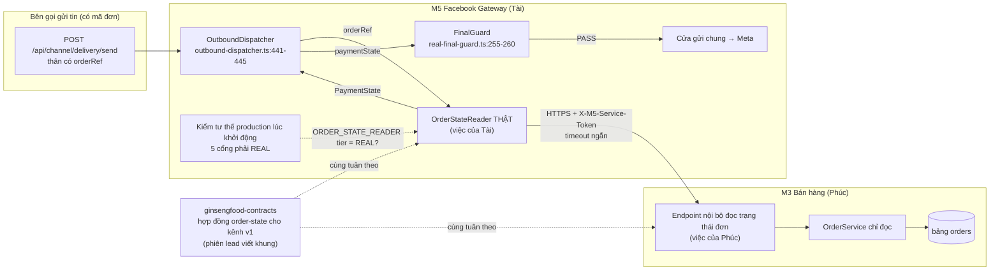
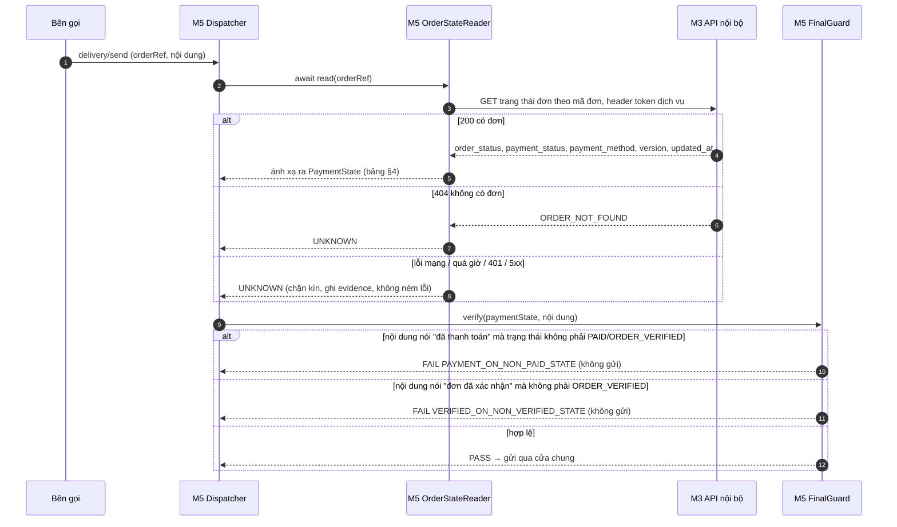
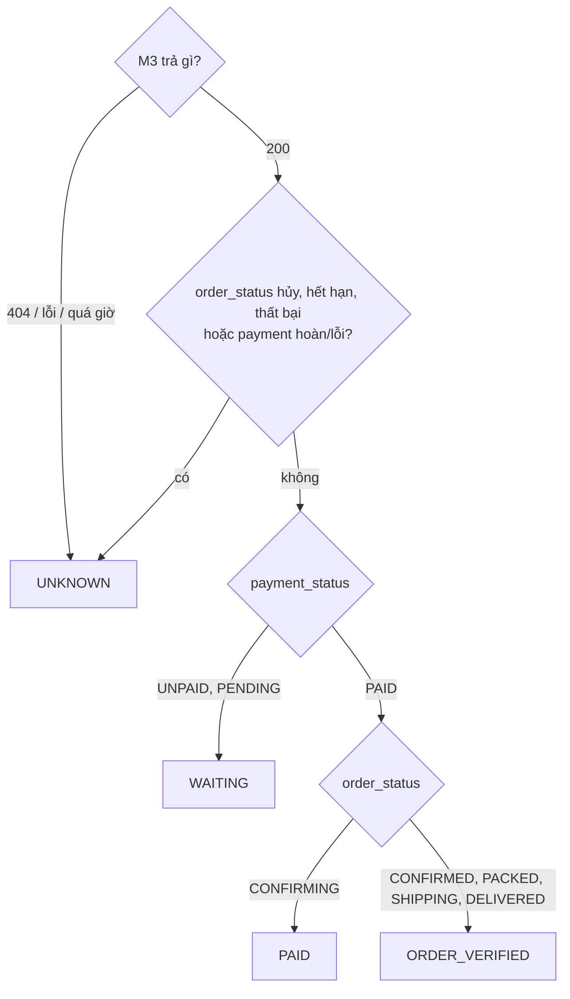
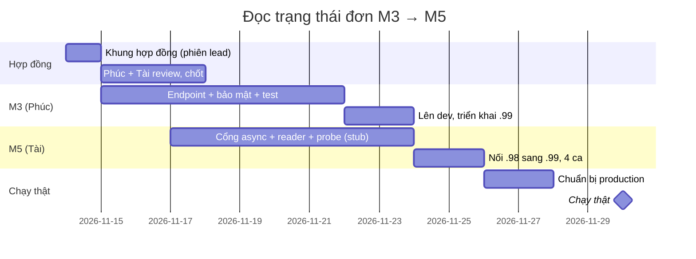

# Giao việc: đọc trạng thái đơn M3 → M5 (`ORDER_STATE_READER` thật)

Soạn 13/11/2026 ở phiên `m5` theo D-m5-036 (Lead chọn C+A cho m5.32). Phiên `lead` dùng tệp này để viết khung hợp đồng và tạo task trên Sheet.
Dữ kiện đọc tại: module5 `2f733b2` (main), business-platform `e0af7b2bd` (`toandeptrai`, trùng `origin/dev`), ginsengfood-contracts `08585c1`.
Máy chủ (D-lead-034/035/036, sửa 13/11 chiều): M5 chạy ở máy mkt 192.168.1.98, M3 + M4 ở 192.168.1.99; không còn .60.
Lưu ý: checkout ginsengfood-contracts đang dở một lần merge (~403 mục, có xung đột), nên nội dung contracts dưới đây có thể đã cũ.

## 1. Vì sao phải làm

- Chế độ production của M5 từ chối khởi động khi cổng `ORDER_STATE_READER` còn là mock (`src/startup/production-adapter-posture.ts:60,80-82`, gọi ở `bootstrap.ts:195`).
  Thiết kế này đúng (M5-017). Hệ quả là M5-115 "mở pilot production 1 Page" không bật được tới khi có reader thật.
- Pilot chạy chế độ phạm vi (`scoped-send-posture.ts`), chế độ này không đòi reader thật, nên **pilot không chờ việc này**.
  Việc này chỉ chặn bước chạy thật 30/11.
- Phía M3 chưa có endpoint đọc đơn cho dịch vụ khác. Endpoint hiện có đều dành cho người dùng: JWT nhân viên (`OrderController.java:58`), admin, khách, khách lẻ tra theo SĐT.
  M3 cũng chưa phát sự kiện đổi trạng thái đơn (`OrderStateMachineImpl.java:459-466`).
- `ginsengfood-contracts` có `GET /v1/orders/{orderId}` (`openapi/business-platform/order.v1.yaml:105-109`), nhưng không dùng được: enum trong hợp đồng
  (`ORDER_*`, `PAYMENT_*`) không khớp enum trong mã, endpoint trả cả đơn, chưa có cách xác thực, và mã M3 chưa làm endpoint này.

## 2. Sơ đồ thành phần

## 3. Sơ đồ tuần tự một lần gửi tin có mã đơn

## 4. Ánh xạ trạng thái M3 → `PaymentState` của M5 (đề xuất, chốt trong hợp đồng + một DL của Tài)

M5 có 5 giá trị (`src/outbound-guard/domain/enums.ts:89-95`): `NONE` (không có mã đơn), `WAITING`, `PAID`, `ORDER_VERIFIED`, `UNKNOWN`.
M3 lưu 3 trường trên đơn (`Order.java:96-133`): `order_status`, `payment_status`, `verification_status`; cùng `payment_method_snapshot` (COD/ONLINE).
Đề xuất để M3 trả **giá trị gốc**, việc ánh xạ nằm trong reader của M5, vì luật chặn là của M5:

| Trạng thái M3 (`order_status` + `payment_status`) | `PaymentState` | Hệ quả ở FinalGuard |
|---|---|---|
| không có đơn (404) | `UNKNOWN` | chặn mọi câu "đã trả tiền", "đơn đã xác nhận" (FR-COM-001) |
| `payment_status` ∈ UNPAID, PENDING | `WAITING` | chặn "đã thanh toán" (IR-M3-01, SMK-014) |
| `payment_status` = PAID, `order_status` = CONFIRMING | `PAID` | cho câu "đã nhận tiền", chặn "đơn đã xác nhận" |
| `payment_status` = PAID, `order_status` ∈ CONFIRMED, PACKED, SHIPPING, DELIVERED | `ORDER_VERIFIED` | cho cả hai câu |
| `order_status` ∈ CANCELLED, EXPIRED, FAILED, hoặc `payment_status` ∈ FAILED, EXPIRED, REFUND_REVIEW, PARTIALLY_REFUNDED, REFUNDED | `UNKNOWN` | chặn cả hai câu |
| lỗi mạng, quá giờ, 401, 5xx | `UNKNOWN` | chặn kín |

Còn phải chốt khi review hợp đồng:
- **Đơn COD đã xác nhận nhưng chưa trả tiền** không có giá trị nào trong enum M5. `ORDER_VERIFIED` đang được tính là đã trả (`real-final-guard.ts:255`).
  Đề xuất tạm cho về `WAITING`: an toàn, nhưng sẽ chặn câu "đơn đã xác nhận" của đơn COD. Tài quyết có thêm giá trị mới hay không.
- `verification_status` (VERIFIED, TRUSTED…) có cần dùng hay không. Đề xuất chưa dùng, vì trường này phục vụ đối soát doanh thu, không phải trạng thái giao tiếp với khách.

## 5. Khung hợp đồng đề xuất (phiên `lead` viết, Phúc + Tài review theo `GOVERNANCE.md:5-12`)

- Tệp: `ginsengfood-contracts/openapi/business-platform/order-channel-state.v1.yaml` (quy ước tên `<miền>.v1.yaml`, `VERSIONING.md:5-7`), có ví dụ trong `examples/`.
- Đường đề xuất: `GET /api/v1/internal/orders/by-code/{orderCode}/channel-state`. Tra theo `order_code` (`Order.java:58`), vì bên gọi gửi tin chỉ có mã đơn.
  Phúc và Tài có thể chốt tra theo `order_id`, nhưng phải thống nhất bên gọi gửi gì trong `orderRef`.
- Trả về 200: `order_code`, `order_status`, `payment_status`, `payment_method`, `version`, `updated_at`. **Không có** tên, SĐT, địa chỉ, số tiền, mặt hàng.
- Lỗi: 404 `ORDER_NOT_FOUND`, 401 `SERVICE_TOKEN_INVALID`, 503 khi cờ tắt. Phân trang, bộ nhớ đệm: không cần.
- Xác thực: theo khuôn M4 đang dùng cho M5 (`SecurityConfig.java:114,131,288,294`). Header `X-M5-Service-Token`, so sánh hằng thời gian.
  Bí mật **riêng** cho đường này (không dùng chung token M4 channel), cờ bật mặc định `false`. Chỉ ghi tên biến trong hợp đồng, không ghi giá trị.
- Yêu cầu không chức năng: p95 ≤ 300 ms trong LAN .98 → .99; M5 đặt timeout 2 000 ms và coi quá giờ là `UNKNOWN`.

## 6. Task giao

### Phúc: M3 (tab M3, người phụ trách Trương Công Phúc)

**Tên:** API nội bộ đọc trạng thái đơn cho M5 (order-channel-state v1). Ưu tiên P0. Hạn **21/11/2026**.
- Cần làm:
  1. Review khung hợp đồng ở §5 cùng Tài, chốt trước 17/11: đường, khoá tra, trường, mã lỗi.
  2. Làm controller và service chỉ đọc ở `order/`. Không đổi trạng thái đơn, không ghi DB.
  3. Gắn cổng token dịch vụ riêng vào `SecurityConfig.java`. Tệp này dùng chung với phần M4 của Tài, nên báo Tài trước khi sửa. Cờ mặc định tắt.
  4. Viết test: 200 / 404 / 401 / cờ tắt, và kiểm câu trả lời không có trường PII.
  5. Snapshot hợp đồng trong `contracts/api-snapshots/` giống cách làm với M8.
  6. PR `PhucApu → dev`.
- Xong khi: test xanh trên `dev`; ví dụ request/response khớp hợp đồng; Tài gọi thử được từ stub hoặc từ .98 sang .99 với 4 ca (đơn chờ trả, đã trả, đã xác nhận, không có).
- Phụ thuộc: khung hợp đồng (phiên `lead`). Chạy trên .99 (M3 cắt sang .99 14/11 22:45, `chung/MAY_CHU.md`): gói `~/m34`, token đặt trong vault; đường `/api/v1/internal/orders/by-code/` chỉ mở cho IP .98.

### Tài: M5 (tab M5, người phụ trách Nguyễn Phát Tài)

**Tên:** `ORDER_STATE_READER` thật đọc trạng thái đơn từ M3. Ưu tiên P0. Hạn **24/11/2026**, chạy nối .98 → .99 trước **26/11**.
- Cần làm:
  1. Đổi cổng sang bất đồng bộ: `read(orderRef): Promise<PaymentState>` (`order-state-reader.port.ts:9-12`).
     Dispatcher `await` có `try/catch` trả `UNKNOWN`, theo cách `windowCheck` đang làm ở `:339-340`.
     Hiện ở `:441-445` lỗi ném ra sẽ làm `dispatch` reject.
  2. Viết lớp `HttpM3OrderStateReader` theo khuôn `http-m4-advisor.ts` (`httpCall`, `configurationErrors()`, mã lỗi riêng), khai `tier='REAL'`.
  3. Chọn lớp bằng biến môi trường mới (`ORDER_STATE_READER_MODE=mock|real` trong `ENV_CHOICES`, `env-reader.ts:21-57`).
     Thêm base URL (`http://192.168.1.99:80`), token, timeout, tên biến `M3_ORDER_STATE_*` theo `chung/MAY_CHU.md`. Hiện lớp đang bind cố định ở `outbound-guard.module.ts:104`.
     Sửa `docs/05-reference/env-reference.md:171-173` và khối env mà probe ghim.
  4. Ghi DL cho bảng ánh xạ §4, gồm cách xử lý đơn COD đã xác nhận.
  5. Sửa các probe đang ghim reader là MOCK: `production-flip-block.probe.ts:219,255-256`, `smk-runner.probe.ts:134`, `smk-evidence-package.probe.ts:162`, `runtime-evidence-source.probe.ts:145`.
     Thêm probe cho reader: đủ 6 dòng bảng §4, quá giờ, 401, và kiểm evidence `order_state_read` chỉ có `orderRef` đã băm.
  6. Không dán `REAL` lên mock. PR có khối CI_LOCAL `GATE=ĐẠT` (D-m5-032).
- Xong khi: probe xanh; khởi động production trên máy tạm không còn `PRODUCTION_POSTURE_MOCK_ADAPTER port=ORDER_STATE_READER`;
  từ .98 gọi API M3 thật trên .99 qua 4 ca; M5-115 chỉ còn chặn bởi các cổng khác.
- Phụ thuộc: hợp đồng chốt 17/11; API M3 lên `dev`/.99.

## 7. Lịch tới 30/11

Không đụng tới Go/No-go pilot (≤ 20/11): pilot dùng chế độ phạm vi.

## 8. Ai làm gì

| Việc | Phúc | Tài | Toàn (phiên `lead`) | Anh Tuấn |
|---|---|---|---|---|
| Khung hợp đồng trong `ginsengfood-contracts` | review | review | viết, gộp | |
| Endpoint M3 | làm | thử gọi | duyệt PR nếu cần | |
| Reader M5 + DL ánh xạ | | làm | rà task | |
| Bí mật token dịch vụ trên .98 và .99 | | đặt | | hạ tầng vault |
| Nối thử .98 → .99 | hỗ trợ | làm | | mạng nội bộ |
